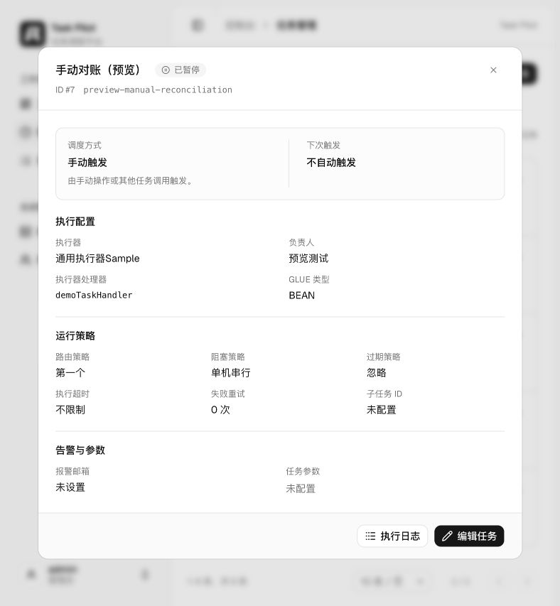
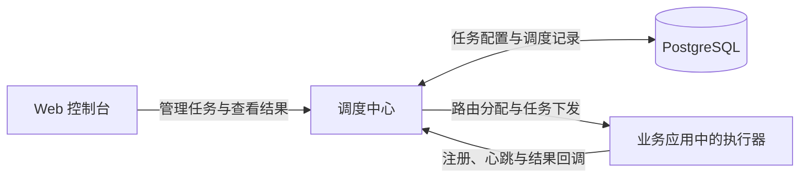

<p align="center">
  
</p>

<h1 align="center">Task Pilot</h1>

<p align="center">
  <strong>让任务调度更清晰，让执行过程可追踪。</strong>
</p>

<p align="center">
  面向 Java / Kotlin 应用的分布式任务调度平台。<br />
  通过注解接入业务任务，在一个控制台完成调度、执行与排障。
</p>

<p align="center">
  <a href="https://github.com/ruishanio/Task-Pilot/actions/workflows/maven.yml"></a>
  <a href="pom.xml"></a>
  <a href="pom.xml"></a>
  <a href="task-pilot-frontend/README.md"></a>
  <a href="LICENSE"></a>
</p>

<p align="center">
  <a href="#功能特性">功能特性</a> ·
  <a href="#界面预览">界面预览</a> ·
  <a href="#快速开始">快速开始</a> ·
  <a href="#接入业务应用">接入业务应用</a> ·
  <a href="#参与贡献">参与贡献</a>
</p>

---

Task Pilot 将调度管理与业务执行分开：调度中心负责管理任务、分配执行节点和记录结果，执行器运行在业务应用中，负责执行具体逻辑。适用于数据同步、定时报表、批量处理、定期清理等后台任务。

你可以在控制台配置任务，也可以使用 `@TaskPilotRegister` 将调度定义随代码一起维护；从查看下一次触发时间，到定位某一次执行的日志，都有对应的管理入口。

## 功能特性

| 能力 | 说明 |
| --- | --- |
| **灵活调度** | 支持 Cron、固定间隔、手动触发和子任务调用，按任务控制启停。 |
| **注解接入** | 使用 `@TaskPilot` 暴露 Spring Bean 方法；使用 `@TaskPilotRegister` 在应用启动时同步任务配置。 |
| **执行器管理** | 节点自动注册与心跳维护，支持自动发现和手动指定执行地址。 |
| **路由与分片** | 提供轮询、随机、一致性 Hash、故障转移、忙碌转移、分片广播等 10 种路由策略。 |
| **执行控制** | 支持执行超时、失败重试、调度过期策略，以及串行、丢弃后续、覆盖之前等阻塞策略。 |
| **多种运行模式** | 支持 Bean、GLUE（Groovy）及 Shell、Python、Node.js、PowerShell、PHP 脚本任务。 |
| **日志与告警** | 查看调度记录、执行结果和实时执行日志，支持日志保留策略与邮件失败告警。 |
| **可视化管理** | 工作台展示调度趋势和结果分布；提供任务筛选、执行器管理、用户角色与执行器访问权限。 |

脚本任务需要执行器所在环境安装相应解释器；邮件告警需要配置 SMTP 服务与任务的告警邮箱。

## 界面预览

管理界面基于 **Vue 3、TypeScript、shadcn-vue 和 Tailwind CSS**，提供工作台、任务管理、调度日志、执行器和用户管理页面，并适配桌面与移动端。

任务详情集中展示调度方式、执行配置、运行策略及告警参数，常用操作直接连接执行日志与任务编辑。

<p align="center">
  
</p>

## 工作原理



调度中心管理触发时间和执行策略，执行器通过 Starter 集成到业务应用中。增加执行器节点后，可以使用路由策略分配任务，或通过分片广播让多个节点分别处理数据。

## 快速开始

### 启动调度中心

准备好 Git、Docker 和 Docker Compose，在终端执行：

```bash
git clone https://github.com/ruishanio/Task-Pilot.git
cd Task-Pilot

# 构建当前源码，Docker 会完成前端和服务端的编译。
docker build -t ruishanio/task-pilot:latest .

# 先启动数据库，待数据库就绪后再启动调度中心。
docker compose up -d postgres
until docker compose exec -T postgres pg_isready -U postgres -d task_pilot; do sleep 2; done
docker compose up -d --pull never task-pilot-admin
```

启动后访问 **[http://localhost:8080/web/](http://localhost:8080/web/)**。

| 项目 | 默认值 |
| --- | --- |
| 登录账号 | `admin` |
| 登录密码 | `123456` |
| 数据库 | PostgreSQL，`localhost:5432/task_pilot` |
| 数据目录 | 仓库下的 `data/`，由 Compose 挂载 |

首次启动时，Flyway 自动初始化表结构和示例配置。Compose 包含数据库和调度中心，**执行器需要通过业务应用或示例工程单独启动**。

### 数据库迁移版本

1.0.7 使用 [`V1_0_7_001__init_task_pilot.sql`](task-pilot-admin/src/main/resources/db/migration/V1_0_7_001__init_task_pilot.sql) 初始化表结构和默认数据，执行器名称支持 64 个字符。

后续脚本按 `V主版本_次版本_修订号_序号__说明.sql` 命名，同一版本从 `001` 递增，例如 `V1_0_7_002__description.sql`。

该脚本用于新库初始化，不负责旧版数据库的结构升级或历史数据修复。已有旧迁移记录的预发布库不能直接沿用；测试库可在确认无需保留数据后重新初始化，需保留数据的数据库应单独制定升级方案。

默认配置用于本地体验。正式部署时，请修改初始密码，并通过外部配置设置数据库凭据、JWT 密钥和调度通信 Token。配置项见 [调度中心配置](task-pilot-admin/src/main/resources/config/application.yml)。

<details>
<summary>查看运行状态与日志</summary>

```bash
docker compose ps
docker compose logs -f task-pilot-admin
```

</details>

## 接入业务应用

以下示例面向 Java 21 / Spring Boot 4.1.2 应用，使用 Kotlin 编写任务；Java 应用也可以使用相同注解。

### 1. 引入 Starter

在业务应用中添加依赖：

```xml
<dependency>
    <groupId>com.ruishanio</groupId>
    <artifactId>task-pilot-spring-boot-starter</artifactId>
    <version>1.0.7</version>
</dependency>
```

如需使用与当前源码一致的 Starter，可先在本仓库根目录安装到本地 Maven 仓库：

```bash
mvn -P '!release' -pl task-pilot-spring-boot-starter -am install -DskipTests
```

### 2. 配置执行器

在业务应用的 `application.yml` 中添加：

```yaml
task-pilot:
  admin:
    addresses: http://localhost:8080
    access-token: "" # 与调度中心的 task-pilot.accessToken 保持一致
    timeout: 3
  executor:
    enabled: true
    appname: my-task-executor
    ip: "" # 留空自动识别，调度中心必须能访问此地址
    port: 9999
    logpath: ${user.home}/logs/task-pilot/taskhandler
    logretentiondays: 30
  sync:
    enabled: true
    executor-title: 示例执行器
```

`admin.addresses` 是执行器访问调度中心的地址；`executor.ip` 和 `executor.port` 是调度中心访问执行器的地址。跨容器或跨主机部署时，需要替换为双方可达的地址，不能直接沿用 `localhost`。

### 3. 声明任务

```kotlin
import com.ruishanio.taskpilot.core.context.TaskPilotHelper
import com.ruishanio.taskpilot.core.handler.annotation.TaskPilot
import com.ruishanio.taskpilot.core.handler.annotation.TaskPilotRegister
import org.springframework.stereotype.Component

@Component
class ReportTask {
    // 启动时同步任务定义，每天 09:00 执行；新建任务默认保持暂停。
    @TaskPilotRegister(
        taskName = "daily-report",
        taskDesc = "每日数据汇总",
        conf = "0 0 9 * * ?"
    )
    @TaskPilot("dailyReportHandler")
    fun generateReport() {
        TaskPilotHelper.log("开始汇总数据，参数：{}", TaskPilotHelper.getTaskParam())
        // 在这里调用业务服务；发生业务失败时可调用 TaskPilotHelper.handleFail。
        TaskPilotHelper.log("数据汇总完成")
    }
}
```

启动业务应用后，在控制台中找到任务，先手动执行并查看日志，再按需启用自动调度。

- `@TaskPilot` 定义执行方法，对应控制台中的「执行器处理器」。
- `@TaskPilotRegister` 配合 `sync.enabled: true` 同步任务定义；再次启动时会按注解更新对应配置。
- 新任务默认暂停；如需注册后立即启动，可显式设置 `autoStart = true`。
- 如果希望只在控制台维护调度配置，保留 `@TaskPilot`，不添加 `@TaskPilotRegister` 即可。

分片广播、HTTP 请求、命令行任务与生命周期回调等示例，见 [Spring Boot 示例工程](task-pilot-executor-samples/task-pilot-executor-sample-springboot)。

## 本地开发

### 环境要求

| 工具 | 版本 |
| --- | --- |
| JDK | 21 |
| Maven | 3.9.x |
| Node.js | 24.x |
| PostgreSQL | 17.x |

服务端使用 Kotlin 2.3.21、Spring Boot 4.1.2、MyBatis 和 Flyway；前端使用 Vite 8、Vue 3、TypeScript 和 Tailwind CSS 4。

### 启动服务端

创建 `task_pilot` 数据库，并按本机环境调整 [数据库连接配置](task-pilot-admin/src/main/resources/config/application.yml)。也可以使用仓库的 `docker compose up -d postgres` 启动开发数据库。

```bash
# 安装调度中心及其依赖模块，然后启动服务端。
mvn -P '!release' -pl task-pilot-admin -am install -DskipTests
mvn -P '!release' -pl task-pilot-admin spring-boot:run
```

服务端默认监听 `8080`。本地开发使用下方 Vite 地址访问界面；Docker 构建则会自动将前端产物打包进调度中心。

### 启动前端

在另一个终端执行：

```bash
cd task-pilot-frontend
npm ci
npm run dev
```

访问 **[http://localhost:5173/web/](http://localhost:5173/web/)**。Vite 默认将管理接口代理到 `http://localhost:8080`；前端配置、构建和检查命令见 [前端开发说明](task-pilot-frontend/README.md)。

<details>
<summary>运行示例执行器</summary>

在仓库根目录执行：

```bash
mvn -P '!release' -pl task-pilot-executor-samples/task-pilot-executor-sample-springboot -am install -DskipTests
mvn -P '!release' -pl task-pilot-executor-samples/task-pilot-executor-sample-springboot spring-boot:run
```

示例应用的 Web 端口是 `8089`，执行器通信端口是 `9999`。启动前检查 [示例配置](task-pilot-executor-samples/task-pilot-executor-sample-springboot/src/main/resources/config/application.yml)，确保调度中心地址、通信 Token 和执行器 IP 与部署环境匹配。

</details>

## 项目结构

| 模块 | 职责 |
| --- | --- |
| [`task-pilot-admin`](task-pilot-admin) | 调度中心、管理 API、权限控制与数据库迁移 |
| [`task-pilot-frontend`](task-pilot-frontend) | Vue 管理界面与可视化报表 |
| [`task-pilot-core`](task-pilot-core) | 执行器、通信协议、任务上下文与运行机制 |
| [`task-pilot-spring-boot-starter`](task-pilot-spring-boot-starter) | Spring Boot 自动配置、任务扫描与启动同步 |
| [`task-pilot-executor-samples`](task-pilot-executor-samples) | Spring Boot 与 Spring AI 执行器示例 |
| [`task-pilot-tool`](task-pilot-tool) | 通用工具与基础支持 |

## 参与贡献

欢迎通过 [Issues](https://github.com/ruishanio/Task-Pilot/issues) 反馈问题、提出功能建议，也欢迎提交 [Pull Request](https://github.com/ruishanio/Task-Pilot/pulls)。

- **反馈问题**：说明使用版本、运行环境、复现步骤与预期结果，附上去除敏感信息后的相关日志。
- **改进代码**：尽量让一次 PR 聚焦一个问题，说明变更目的、影响范围和验证方式。
- **完善文档**：修正示例、补充使用场景和改进接入说明，同样是有价值的贡献。

## 开源许可

Task Pilot 使用 **[GNU General Public License v3.0](LICENSE)** 开源。第三方前端组件的许可说明见 [THIRD_PARTY_NOTICES.md](task-pilot-frontend/THIRD_PARTY_NOTICES.md)。
